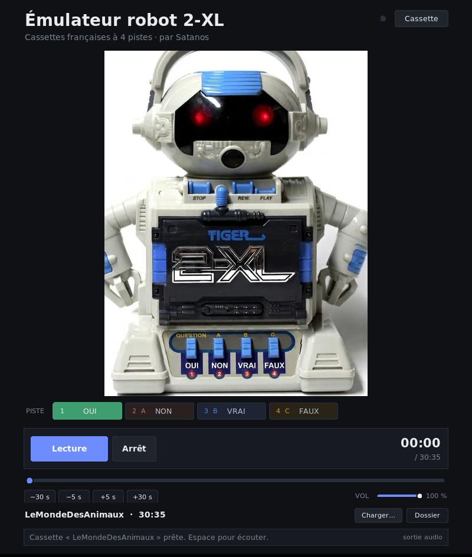

# Émulateur robot 2-XL

Projet de **Satanos**. Réalisé avec une IA, via Arena en mode agent.

Émulateur du robot parlant **2-XL** de Tiger, dans sa version à cassette compacte, pour les
**cassettes françaises à quatre pistes**.

Sur le jouet d'origine, les quatre boutons `OUI`, `NON`, `VRAI` et `FAUX` ne déclenchent pas quatre
enregistrements séparés : les quatre réponses sont enregistrées côte à côte sur la même cassette, et
chaque bouton choisit la tête de lecture correspondante. La bande continue d'avancer pendant que
l'enfant appuie. Cette application reproduit exactement ce fonctionnement : les quatre pistes
avancent ensemble, et choisir une réponse revient à changer de tête de lecture, sans rembobiner.

Correspondance des boutons, telle qu'elle est indiquée dans l'application :

| Bouton | Réponse |
|---|---|
| `1` | OUI |
| `2 A` | NON |
| `3 B` | VRAI |
| `4 C` | FAUX |



## Sommaire

- [Téléchargement](#téléchargement)
- [Installation](#installation)
- [Les cassettes françaises](#les-cassettes-françaises)
- [Préparer une cassette](#préparer-une-cassette)
- [Utilisation](#utilisation)
- [Raccourcis clavier](#raccourcis-clavier)
- [Réglages conservés](#réglages-conservés)
- [En cas de problème](#en-cas-de-problème)
- [Mentions](#mentions)

## Téléchargement

Le programme se télécharge dans l'onglet **Releases** du dépôt : prends le fichier
`Emulateur-2XL-2.1.2-windows.zip`, décompresse-le, et lance `Emulateur-2XL.exe`.

Les cassettes audio ne sont pas fournies.

## Installation

### Windows

1. Décompresse l'archive `Emulateur-2XL` où tu veux.
2. Ouvre le dossier et double-clique sur `Emulateur-2XL.exe`.

Aucune installation n'est nécessaire, Python n'a pas besoin d'être présent sur la machine.

Au premier lancement, Windows peut afficher un avertissement de sécurité, car le programme n'est pas
signé numériquement. Clique sur **Informations complémentaires**, puis sur **Exécuter quand même**.

### macOS et Linux

Le programme fonctionne aussi depuis les sources, avec Python 3.10 ou plus récent :

```bash
python -m pip install -r requirements.txt
python -m twoxl run
```

Sous Linux, le paquet système PortAudio doit être installé (`sudo apt install libportaudio2` sur
Debian et Ubuntu).

## Les cassettes françaises

L'émulateur est prévu pour les cassettes publiées en France par Tiger au début des années 1990.
Les titres suivants sont documentés par les collectionneurs :

| Cassette | Contenu |
|---|---|
| A la découverte de 2-XL | Cassette d'introduction livrée avec le robot, présentant son fonctionnement |
| Histoires extraordinaires | Récits et anecdotes surprenantes |
| Voyage intersidéral | Découverte de l'espace |
| Monstres, mythes et dinosaures | Créatures légendaires et animaux disparus |
| Rires et jeux | Devinettes, blagues et petits jeux |
| Au pays des contes | Histoires à choix multiples |
| Le Monde des animaux | Le règne animal |

Ces cassettes ne sont pas fournies avec l'application : tu utilises les enregistrements que tu
possèdes déjà, sous forme de quatre fichiers audio par cassette.

Les cassettes anglaises et les cartouches huit pistes du 2-XL de 1978 ne sont pas prises en charge :
le programme est volontairement limité au format français à quatre pistes.

## Préparer une cassette

Crée un dossier par cassette dans le répertoire `cassettes`, à côté de `Emulateur-2XL.exe`, puis
places-y quatre fichiers audio :

```text
Emulateur-2XL.exe
cassettes/
└── Le Monde des animaux/
    ├── Track1.mp3    correspond à OUI
    ├── Track2.mp3    correspond à NON
    ├── Track3.mp3    correspond à VRAI
    └── Track4.mp3    correspond à FAUX
```

Les noms de fichiers suivants sont reconnus automatiquement, quelle que soit la casse :

| Bouton | Touche | Noms de fichier acceptés |
|---|---|---|
| `1` OUI | `1` | `Track1`, `Piste 1`, `1`, `OUI` |
| `2` A NON | `2` ou `A` | `Track2`, `Piste 2`, `2`, `NON` |
| `3` B VRAI | `3` ou `B` | `Track3`, `Piste 3`, `3`, `VRAI` |
| `4` C FAUX | `4` ou `C` | `Track4`, `Piste 4`, `4`, `FAUX` |

Les formats MP3, WAV, FLAC, OGG, M4A, AIFF et OPUS sont acceptés. Pour une piste en MP3, une qualité
de 128 kbit/s suffit largement, le jouet d'origine étant lui-même monophonique.

Les quatre pistes doivent être des fichiers **déjà séparés** et orientés dans le bon sens :
l'application ne découpe pas une cassette stéréo et ne remet pas les pistes à l'endroit.

Pour utiliser un dossier situé ailleurs sur le disque, clique sur **Charger…** puis sur
**Choisir un dossier…** ; l'emplacement est retenu pour les fois suivantes.

## Utilisation

1. **Choisir une cassette.** Au démarrage, la dernière cassette utilisée est rechargée automatiquement.
   Sinon, clique sur **Charger…** et sélectionne le dossier de la cassette.
2. **Choisir une réponse.** Clique sur la pastille `1 OUI`, `2 A NON`, `3 B VRAI` ou `4 C FAUX`, ou
   directement sur le bouton correspondant de la photo du robot. Le changement est immédiat, même en
   cours de lecture.
3. **Écouter.** Le bouton principal affiche **Lecture** quand rien ne joue, **Pause** pendant la
   lecture et **Reprendre** après une pause. **Arrêt** ramène la bande au début.
4. **Se déplacer.** Fais glisser le curseur de position, ou utilise les boutons `-30 s`, `-5 s`,
   `+5 s`, `+30 s`. Le déplacement s'applique aux quatre pistes en même temps : la réponse suivante
   arrive toujours au bon moment.
5. **Régler le volume.** Le curseur `VOL` agit immédiatement, et le niveau choisi est mémorisé.

La diode à côté du titre indique l'état de la lecture : grise à l'arrêt, orange en pause, verte
pendant la lecture.

### Ce qu'il faut savoir

- La cassette s'arrête à la fin de la piste la plus courte. Si les quatre fichiers n'ont pas
  exactement la même durée, un message le signale au chargement.
- Changer de réponse en cours de lecture ne provoque ni coupure ni décalage.
- Sans cassette chargée, les boutons restent sans effet et l'application affiche un rappel.
- Le programme est utilisable au clavier seul, et la fenêtre peut être redimensionnée.

## Raccourcis clavier

| Touche | Action |
|---|---|
| `Espace` ou `Entrée` | Lecture ou pause |
| `S` ou `Échap` | Arrêt |
| `Flèche gauche` ou `Flèche droite` | Reculer ou avancer de 5 secondes |
| `Maj` + flèche | Reculer ou avancer de 30 secondes |
| `Origine` | Revenir au début |
| `1` `2` `3` `4` ou `A` `B` `C` | Choisir OUI, NON, VRAI, FAUX |
| `O` | Ouvrir le choix des cassettes |
| `F1` | Afficher l'aide |

## Réglages conservés

Le volume, la dernière cassette utilisée et la liste des cassettes récentes sont mémorisés dans un
fichier `config_2xl.json`, placé à côté du programme. Si ce dossier n'est pas accessible en écriture,
le fichier est enregistré dans le profil de l'utilisateur :

- Windows : `%APPDATA%\2XL-FR\`
- macOS : `~/Library/Application Support/2XL-FR/`
- Linux : `~/.config/2XL-FR/`

Supprimer ce fichier remet le programme dans son état initial, avec le volume à 100 %.

## En cas de problème

| Symptôme | Solution |
|---|---|
| Message d'erreur sur la sortie audio | Un autre logiciel occupe peut-être le son. Ferme-le, vérifie qu'un casque ou des enceintes sont branchés, puis relance l'application. |
| Aucune cassette trouvée | Le dossier `cassettes` doit se trouver à côté de `Emulateur-2XL.exe`, avec un sous-dossier par cassette. |
| Les réponses ne correspondent pas | L'ordre des fichiers est incorrect : `Track1` correspond à OUI, `Track2` à A (NON), `Track3` à B (VRAI) et `Track4` à C (FAUX). |
| Le son grésille ou se coupe | Ferme les applications les plus gourmandes, puis relance la lecture. |
| Windows bloque le programme | Clique sur **Informations complémentaires**, puis sur **Exécuter quand même**. |

Pour établir un diagnostic, ouvre une invite de commandes dans le dossier du programme et lance :

```text
Emulateur-2XL.exe check
```

Le programme indique alors si le son, la lecture des MP3 et l'affichage fonctionnent correctement,
et signale les éventuelles anomalies dans un dossier de cassettes.

## Mentions

2-XL est un jouet créé par Michael J. Freeman. La version à cassette compacte à quatre pistes a été
commercialisée par Tiger Electronics à partir de 1992.

Émulateur robot 2-XL est un projet de Satanos, réalisé avec une IA via Arena en mode agent.
Outil d'émulation gratuit, sans affiliation avec Tiger, Hasbro ou les titulaires des droits sur les
cassettes. Les enregistrements audio restent la propriété de leurs ayants droit et ne sont pas
distribués avec le programme.

Version 2.1.2.
